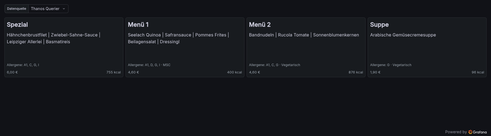

# Kantine — Aramark-Speiseplan in Grafana

Zeigt das Essen des aktuellen Tages einer Aramark-Kantine als Kacheln in
Grafana. Ein kleiner Pod holt den Wochenplan über die API der App
*Mein Aramark Restaurant* (Backend: qnips) und stellt ihn als
Prometheus-Metriken bereit. Keine Datenbank, kein eigenes Image.



> **Inoffiziell.** Die Schnittstelle ist undokumentiert und aus der App
> nachgebaut. Ein App-Update kann sie jederzeit ändern — dann schlägt der
> Alarm `KantineSpeiseplanVeraltet` an (siehe [Wenn es bricht](#wenn-es-bricht)).
> Abgerufen wird nur alle 6 h, mit der Standort-PIN, die auch in der App
> verwendet wird.

## Aufbau

| Pfad | Zweck |
|---|---|
| `deploy/` | Alles, was im Namespace läuft — **ohne** Namespace-Objekt (für OpenShift-Projekte und GitOps) |
| `deploy/src/kantine.py` | Abruf, Aufbereitung, `/metrics` auf Port 9100; nur Python-Standardbibliothek, ~200 Zeilen |
| `deploy/config.env` | Abruf-Intervall, Proxy, Platzhalter für die Standort-PIN |
| `deploy/50-deployment.yaml` | ein Pod, distroless-Python als Nicht-root, read-only Root-FS |
| `deploy/70-servicemonitor.yaml`, `71-prometheusrule.yaml` | Scrape durch den Prometheus Operator, Alarm bei veraltetem Plan |
| `deploy/80-networkpolicies.yaml` | eingehend nur Prometheus |
| `kustomization.yaml`, `namespace.yaml` | Für normales Kubernetes: legt zusätzlich den Namespace `kantine` an (PSA `restricted`) |
| `dashboard/kantine.json` | Grafana-Dashboard zum Importieren |
| `dashboard/build.py` | erzeugt `kantine.json` (Reihenfolge der Ausgaben anpassen, dann neu bauen) |

Skript und `config.env` werden per Kustomize zu ConfigMaps mit Hash-Suffix —
jede Änderung rollt den Pod automatisch neu aus.

## Installation

Die Standort-PIN (aus der App bzw. vom Aushang der Kantine) hat zwei
mögliche Orte — steht sie in beiden, gewinnt das Secret:

- **Secret `kantine`** (Key `KANTINE_PIN`), einmal von Hand angelegt — für
  öffentliche Repos und überall, wo die PIN nicht ins Git soll.
- **`deploy/config.env`** — Zeile `KANTINE_PIN=` einkommentieren. Nur in einem
  privaten Repo bzw. Fork; dann ist kein Secret nötig und alles kommt per GitOps.

Die Befehle unten zeigen den Weg über das Secret; mit PIN in `config.env`
entfällt die `create secret`-Zeile.

### OpenShift

```bash
oc new-project kantine
oc create secret generic kantine --from-literal=KANTINE_PIN=<PIN>
oc apply -k deploy/
oc logs -f deploy/kantine        # "N Gerichte an M Tagen"
```

Der Pod läuft unverändert unter der Standard-SCC `restricted-v2` (kein festes
`runAsUser`, OpenShift vergibt die UID).

### Kubernetes

```bash
kubectl apply -f namespace.yaml
kubectl -n kantine create secret generic kantine --from-literal=KANTINE_PIN=<PIN>
kubectl apply -k .               # Namespace kantine + deploy/
kubectl -n kantine logs -f deploy/kantine
```

### GitOps (Argo CD o. ä.)

Pfad `deploy/` mit Ziel-Namespace (OpenShift, Namespace existiert) oder Pfad
`.` (Kubernetes, Namespace wird mit angelegt). Die PIN in einem privaten Fork
in `deploy/config.env` eintragen, sonst das Secret `kantine` vorher von Hand
anlegen — oder verschlüsselt mitliefern, siehe
[PIN verschlüsselt im Repo](#pin-verschlüsselt-im-repo-optional).

**Fork mit Pull-Mirror:** Eigene Änderungen wie die PIN in `config.env` nicht
auf den gespiegelten Branch committen — der Mirror überschreibt sie oder bleibt
hängen. Besser ein eigener Branch (z. B. `betrieb`) als `targetRevision`, auf
den man Updates von `main` übernimmt.

## Checkliste für die Zielumgebung

1. **Image erreichbar?** `gcr.io/distroless/python3-debian13:nonroot` (per
   Digest gepinnt). Ist `gcr.io` gesperrt: ins eigene Registry spiegeln und das
   Image in `deploy/50-deployment.yaml` ersetzen.
2. **Ausgehender Verkehr** zu `api.qnips.com`, `identitytoolkit.googleapis.com`
   und `firestore.googleapis.com` (HTTPS). Hinter einem Proxy `HTTPS_PROXY`
   (und ggf. `NO_PROXY`) in `deploy/config.env` setzen. Egress-Firewalls
   (z. B. OpenShift `EgressFirewall`) entsprechend freigeben.
3. **Prometheus findet den ServiceMonitor?** Braucht den Prometheus Operator.
   - *OpenShift:* User Workload Monitoring muss aktiv sein (Admin:
     `enableUserWorkload: true` in der ConfigMap `cluster-monitoring-config`
     im Namespace `openshift-monitoring`).
   - *Eigener Prometheus:* `serviceMonitorSelector` /
     `serviceMonitorNamespaceSelector` müssen den ServiceMonitor erfassen
     (ggf. Labels in `70-servicemonitor.yaml` ergänzen). Gleiches gilt für
     die PrometheusRule (`ruleSelector`).
   - Ohne Prometheus Operator: die beiden Dateien aus
     `deploy/kustomization.yaml` streichen und `:9100/metrics` anders scrapen.
4. **NetworkPolicy:** erlaubt Scrapes aus den Namespaces `monitoring`,
   `openshift-monitoring` und `openshift-user-workload-monitoring`. Läuft
   Prometheus woanders, den Namespace in `deploy/80-networkpolicies.yaml`
   ergänzen.
5. **Test:** In Prometheus `count(kantine_gericht_info{aktuell="1"})` abfragen
   (Zahl der Gerichte heute) und `kantine_abruf_letzter_erfolg_timestamp_seconds`
   (darf nicht `0` sein).

## Grafana-Dashboard

`dashboard/kantine.json` importieren (*Dashboards → New → Import*, oder als
`GrafanaDashboard`-Ressource beim Grafana Operator). Keine Plugins nötig;
getestet mit Grafana 13.

- Oben links wählt **Datenquelle** die Prometheus-Quelle. Beim Import wird die
  Standardquelle genommen — gibt es mehrere, die mit den Kantinen-Metriken
  auswählen und das Dashboard speichern.
- *OpenShift:* Die Metriken liegen im User Workload Monitoring; Grafana fragt
  sie über den Thanos Querier ab
  (`https://thanos-querier.openshift-monitoring.svc.cluster.local:9091`,
  Bearer-Token eines ServiceAccounts mit `cluster-monitoring-view`).
- Gezeigt wird nur der aktuelle Tag, eine Kachel je Ausgabe in der Reihenfolge
  aus `AUSGABEN` in `dashboard/build.py`; was es an dem Tag nicht gibt, fehlt.
  Für eine andere Kantine die Liste anpassen und `python3 dashboard/build.py`
  ausführen.
- Die Kacheln sind fertiges HTML aus dem Exporter (Label `kachel`), Grafana
  rendert sie in Textpanels. Das Textpanel braucht dafür HTML — Grafanas
  Standardeinstellung.

## Konfiguration (`deploy/config.env`)

| Variable | Standard | Bedeutung |
|---|---|---|
| `KANTINE_PIN` | — | Standort-PIN aus der App — hier (nur privates Repo) oder im Secret `kantine`, das Vorrang hat. Fehlt sie, beendet sich der Pod mit einer Meldung |
| `REFRESH_SECONDS` | `21600` | Abruf-Intervall (6 h) |
| `RETRY_SECONDS` | `900` | neuer Versuch nach einem Fehler |
| `HTTPS_PROXY`, `NO_PROXY` | — | Firmen-Proxy, falls nötig |

## PIN verschlüsselt im Repo (optional)

In einem privaten Repo reicht `deploy/config.env`. In einem öffentlichen
gehört die PIN ins Cluster-Secret. Wer das Secret trotzdem per GitOps verwalten
will, hat drei übliche Wege — alle ersetzen nur das manuelle `create secret`,
das Deployment bleibt gleich:

| Weg | Wie | Haken |
|---|---|---|
| [Sealed Secrets](https://github.com/bitnami-labs/sealed-secrets) | `kubeseal` verschlüsselt mit dem öffentlichen Schlüssel des Clusters → `SealedSecret` ins Repo, ein Controller im Cluster entschlüsselt | Controller nötig; die Datei passt nur zu genau einem Cluster |
| [SOPS](https://github.com/getsops/sops) + age | Datei im Repo verschlüsselt, Schlüssel liegt beim Deployer bzw. in Argo CD (KSOPS-Plugin) | Argo CD braucht das Plugin, Schlüssel muss verteilt werden |
| [External Secrets](https://external-secrets.io) | PIN liegt im Firmen-Tresor (Vault o. ä.), im Repo nur ein `ExternalSecret`-Verweis | Operator und Tresor nötig |

In einem öffentlichen Repo ist auch die verschlüsselte PIN „da“ — nur ohne
Schlüssel nicht lesbar. Ganz weglassen ist deshalb die einfachste Variante.

## Metriken

| Metrik | Inhalt |
|---|---|
| `kantine_gericht_info` | ein Eintrag je Gericht, alle Angaben als Label: `datum`, `aktuell` (`1` = heute bzw. am Wochenende der nächste Kantinentag), `kategorie`, `gericht`, `preis` (Mitarbeiterpreis), `kcal`, `allergene`, `kennzeichnung`, `kachel` |
| `kantine_abruf_letzter_erfolg_timestamp_seconds` | Zeitpunkt des letzten erfolgreichen Abrufs (`0` bis zum ersten) |

Der Speiseplan liegt nur im Speicher des Pods; anschauen per
`kubectl port-forward deploy/kantine 9100` → `http://localhost:9100/metrics`.

**Achtung beim Ändern von `kachel`:** Das Dashboard holt das HTML per
`query_result()` in eine Variable und zerlegt die Zeile per Regex. Im HTML
darf deshalb **nie** ein `"` stehen (Attribute in `'`, Texte per
`html.escape`).

## Wie der Abruf funktioniert

Nachgebaut aus der App `de.aramark.new` (Version 2026.1.14):

1. `GET https://api.qnips.com/cons/api/NewIdentity` — anonyme Identität, wie
   bei einer App-Installation; danach Header `Authorization: 0<ApiKey>`.
2. `POST Stores/Unlock` mit `{"Type": 0, "Code": "<PIN>"}` → IDs der
   freigeschalteten Standorte (`Type 1` wäre der Inhalt des QR-Codes).
3. `GET FirebaseInfo` → Custom Token → Firebase-Login (Projekt `q-aramark`).
4. Firestore `/<Environment>/<Sprache>/Stores/<id>` → Menü-IDs, dann
   `/<Environment>/<Sprache>/Menus/<id>/Years/<Jahr>/Weeks/<ISO-KW>` — das
   Wochen-Dokument enthält alle Tage.

Die nächste Woche erscheint erst kurz vor Wochenbeginn (vorher 404, wird
übersprungen). Am Wochenende zeigt `aktuell="1"` den nächsten Kantinentag,
sobald er veröffentlicht ist.

## Wenn es bricht

`KantineSpeiseplanVeraltet` (Plan älter als 26 h) heißt meist: Ein App-Update
hat die API verändert. Erst die Logs des Pods lesen; nach jedem Fehler holt
das Skript beim nächsten Versuch eine frische Identität. Hilft das nicht:
aktuelle APK mit
[jadx](https://github.com/skylot/jadx) dekompilieren und vergleichen:

- `io/qnips/api/AppsApi.java` — Endpunkte
- `io/qnips/api/Backend.java` — Header (`App-Feature-Set`, `User-Agent`)
- `io/qnips/firebase/MenuSubscriber.java` — Firestore-Pfade
- `res/values/strings.xml` — Firebase-Projekt und API-Key
